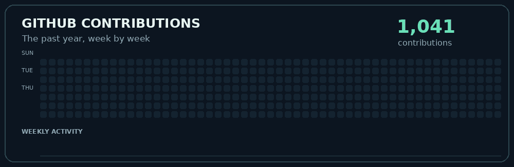

# Vivaan Patni

**Independent researcher in computational and mathematical biology**

I work across computational biology, mathematical biology and pure mathematics. I use models, public biological data and reproducible software to study sequences, regulation, proteins, cell states and disease. I care about the boundary between what a calculation establishes and what still needs biological validation.

## Research

- **RNA and gene regulation:** synonymous sequence spaces, RNA structure, perturbation experiments and transcriptional response.
- **Cancer and cell states:** single-cell and spatial transcriptomics, glioblastoma tissue geometry, and synthetic ctDNA decision-model simulations.
- **Protein science:** bacteriocin sequence and activity analyses, protein architecture, oligomeric-state evolution and structural bioinformatics.
- **Neuroscience and systems biology:** stochastic neurogenesis, glutamate uptake, synaptic signalling, reaction-network simulations and bioelectric tissue models.
- **Mathematics:** graph and spectral methods, persistent topology and Hodge theory, molecular geometry, algebraic methods, numerical analysis and polynomial-root geometry.
- **Research practice:** exact enumeration where feasible, independent implementation checks, held-out evaluation, sensitivity analysis, data provenance and reproducible releases.

## Main project · OpenOmicsBench

**[OpenOmicsBench](https://github.com/vxxqv/openomicsbench)** is an offline collection of omics benchmarks and tools for testing bioinformatics workflows. It includes RNA-seq input packs, deterministic sequence fixtures, single-cell and genomic interval data, and reports that make checks traceable.

[Browse the benchmarks](https://vxxqv.github.io/openomicsbench/) · [Try a worked RNA-seq example](https://github.com/vxxqv/openomicsbench#try-one-rna-seq-study) · [Read the documentation](https://github.com/vxxqv/openomicsbench/tree/main/docs)

## Research methods

**Biological data and modelling**

**Mathematics, statistics and validation**

## Languages and research tools

**Most of my research code:**

**Also comfortable in:**

**Workflows and model formats**

**Computer algebra, topology and formal methods**

## GitHub activity

The graph shows GitHub contributions over the past year and refreshes daily.

## Get in touch

For research or software questions, [email me](mailto:contact.vpatni@gmail.com) or [open an issue](https://github.com/vxxqv/openomicsbench/issues) on the relevant project.
